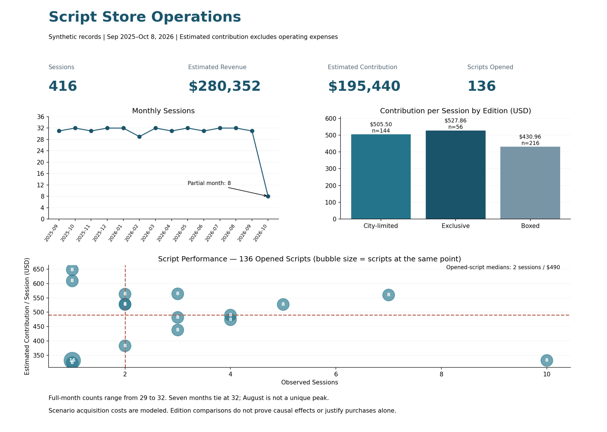

# Script Store Operations Analysis

An Excel portfolio case study of synthetic scripted mystery game operations, estimated contribution, and acquisition-cost recovery.

**All published records are fictional. This project does not demonstrate actual store growth or realized financial impact.**

## Open and inspect

- [Download the Excel workbook](workbook/Script_Store_Operations_Synthetic_Compatible.xlsx) to inspect formulas, formula-based summaries, three charts, and reconciliation checks.
- [View the Dashboard PDF](Script_Store_Operations_Dashboard_Synthetic.pdf) for a static overview.
- Read [findings](docs/findings.md), [metric definitions](docs/methodology.md), [data dictionary](docs/data-dictionary.md), and [validation results](docs/validation.md).

## Business question

Which scripts warrant scheduling, promotion, or further demand testing when acquisition costs are uncertain? The analysis distinguishes popularity, contribution per session, and acquisition-cost recovery.

## Verified synthetic scope

| Measure | Value |
| --- | ---: |
| Fictional scripts | 160 |
| Sessions | 416 |
| Opened scripts | 136 |
| Reporting period | September 1, 2025–October 8, 2026 |
| Estimated revenue | $280,352 |
| Standard DM wages | $84,912 |
| Estimated contribution | $195,440 |

These totals were independently recomputed from the supplied synthetic session rows. Contribution is estimated revenue less total standard DM wage, not net profit.

## Findings

- Full-month session counts range from 29 to 32; seven months tie at 32. The generated data do not show sustained growth.
- City-limited scripts average $505.50 contribution per session (144 sessions), exclusive $527.86 (56), and boxed $430.96 (216). These modeled differences do not establish causation or justify purchases alone.
- October contains eight sessions through October 8 and is excluded from full-month comparisons.
- The performance matrix contains 136 opened scripts. Median cutoffs are two observed sessions and $490 contribution per session, calculated over opened scripts.

## Excel workflow

1. `Start Here` explains navigation and limitations.
2. `Raw Data` stores one synthetic session per row; `Script List` stores one fictional script per row.
3. Revenue, wage lookups, contribution, script counts, scenario surpluses, and segments use formulas.
4. `Assumptions` exposes the acquisition-cost conversion rate (7.2 RMB/USD), reporting dates, and median cutoffs.
5. `Analysis` contains summaries for monthly activity, type economics, edition economics, recovery, and strategy segments. In this compatibility edition, formula summaries replace native PivotTables.
6. `Checks` reconciles counts, keys, totals, and script/session aggregates.
7. `Dashboard` shows formula-linked summaries and three charts.

## Updating the workbook

Open in Excel with automatic calculation enabled. This edition uses bounded worksheet ranges rather than structured references and omits native PivotTables to reduce compatibility risks. Dashboard helper formulas recalculate. The top-20 list and scatter membership are snapshot selections; adding sessions to previously unopened scripts or new scripts requires updating those helper ranges. See [workbook usage](docs/workbook-handoff.md).

## What this case demonstrates

Excel Tables, lookup and conditional aggregation formulas, explicit data grain, reconciliation, contribution modeling, acquisition-cost scenarios, and cautious interpretation of business metrics. SQL, causal attribution, statistically significant edition differences, and independently achieved commercial results are not demonstrated.

## Validation and corrections

The submitted workbook contained stale pre-synthetic PivotTable caches and displayed summaries. The public copy was rebuilt from verified synthetic rows rather than publishing those caches. The obsolete 66-session peak and malformed scatter matrix were corrected. The acquisition assumption was aligned with the synthetic costs at 7.2 RMB/USD.

Independent controls, formula error scans, and input-change tests passed on the compatibility edition. A user screenshot showed broken references and layout in the previous edition. That file was replaced with a standard XlsxWriter export using explicit ranges and no custom pivot XML. Desktop Excel opening and chart rendering still require confirmation.

## Rebuild the static preview

Install `openpyxl` and `matplotlib`, then run `python scripts/build_preview.py`. It reads the published workbook's cached values and exports the PNG and PDF. Recalculate and save the workbook in Excel first if inputs change. The static preview is a presentation of the same calculations, not a screenshot of Excel.

## Limits

Modeled revenue omits actual discounts and transaction adjustments. Standard DM wage is a supplied total session input. Acquisition costs are assumptions; contribution excludes rent, utilities, taxes, and other operating expenses. Session duration and capacity are unavailable. Synthetic outcomes support method demonstration only.
