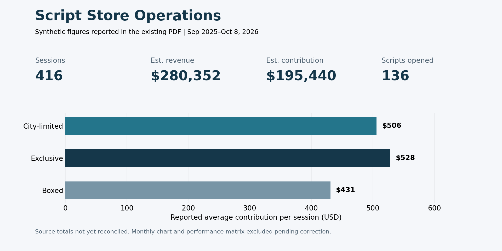

# Script Store Operations Analysis

Excel analysis of fictional scripted mystery game operations: session activity, modeled contribution, and acquisition-cost recovery.

**All published figures are synthetic. They do not describe a real store or demonstrate actual business impact.**

## Start here

1. Read the [findings and decision limits](docs/findings.md).
2. Review the [metric definitions](docs/methodology.md) and [data dictionary](docs/data-dictionary.md).
3. Check the [validation record](docs/validation.md) before interpreting the historical dashboard.
4. Open the [existing Dashboard PDF](Script_Store_Operations_Dashboard_Synthetic.pdf).

**Current evidence limits:** the Excel source workbook is not included. Its formulas, PivotTables, refresh behavior, and row-level totals have not been independently verified. The existing PDF has a monthly-volume inconsistency and a visibly malformed performance matrix; see the validation record. The preview above intentionally includes only legible reported metrics, not those disputed charts.

## Business problem

A store needs to decide which scripts warrant scheduling, promotion, or further demand testing, while accounting for uncertain acquisition costs. This project separates session volume, contribution per session, and acquisition-cost recovery rather than treating popularity as profitability.

## Published scope

The existing project description reports 160 fictional scripts and 416 fictional sessions from September 2025 through October 8, 2026. The PDF reports 136 scripts opened. These are published summary figures, not independently reconciled record counts.

| PDF-reported measure | Value | Interpretation |
| --- | ---: | --- |
| Sessions | 416 | Reported session total |
| Estimated gross revenue | $280,352 | Modeled revenue, not cash received |
| Estimated contribution | $195,440 | Revenue less modeled standard DM wages |
| Scripts opened | 136 | Reported distinct scripts with sessions |

## Analysis approach

The intended Excel workflow links session records to script attributes, calculates modeled revenue and wages, aggregates session activity and contribution, and evaluates low/base/high acquisition-cost scenarios. The documentation explains the required grain, aggregation, and missing-data behavior. Source-workbook implementation remains to be checked.

The project focuses on Excel Tables, lookups, conditional aggregation, PivotTables, visual reporting, and scenario reasoning. SQL, causal inference, and realized business improvements are not demonstrated by the published artifacts.

## Repository guide

| File | What a reviewer can inspect |
| --- | --- |
| `docs/data-dictionary.md` | Proposed field contract and record grain |
| `docs/methodology.md` | Metric definitions, assumptions, aggregation rules |
| `docs/findings.md` | Numerical observations and conditional decisions |
| `docs/validation.md` | Checks actually performed and unresolved issues |
| `docs/workbook-handoff.md` | Requirements for adding the synthetic Excel workbook |
| `assets/metrics-preview.png` | Readable preview of reported synthetic figures |
| `Script_Store_Operations_Dashboard_Synthetic.pdf` | Historical dashboard, with known issues |

## Limitations

Revenue may differ from cash receipts because membership discounts and transaction adjustments are not modeled. Contribution excludes rent, utilities, taxes, and other operating costs. Acquisition costs are scenario assumptions. October is incomplete. Edition comparisons are observational within synthetic data; they do not prove an edition causes better economics. No source business records are required for this public demonstration.

## Reproduce and inspect

The preview can be rebuilt with `python scripts/build_preview.py` after installing Matplotlib. This reproduces the presentation of PDF-reported figures only. Reproducing the underlying analysis requires the Excel workbook described in the handoff document.
